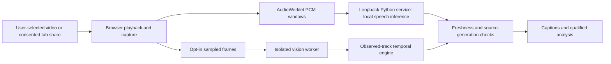

# Local Match Player — Local Inference & Runtime Reliability

A Python/JavaScript sports-player project exploring local captions, camera-visible football analysis, and the engineering needed to keep asynchronous media results timely and trustworthy.

**This repository is a portfolio case study with selected runnable source examples. It is not the full player distribution or a hosted streaming service.** The complete application runs locally on Windows. Models, media, provider catalogues and private working artifacts are not bundled here.

## Engineering highlights

- **Local speech recognition:** AudioWorklet converts browser audio into overlapping four-second 16 kHz PCM windows. The application uses a local small.en model through faster-whisper/CTranslate2, CUDA when available, and visible CPU fallback.
- **Backpressure:** One active caption request and one replaceable pending window prevent an ever-growing backlog. Adaptive one-/two-second scheduling responds to processing cost while preserving context.
- **Runtime isolation:** The full application keeps vision inference in a separate DirectML/ONNX Runtime worker with bounded IPC waits, rather than changing the speech runtime's dependencies.
- **Freshness and lifecycle:** Source changes, pauses, seeking, timeouts and camera cuts invalidate old evidence. Camera-visible estimates are withheld when evidence is insufficient.
- **Honest analytics:** Anonymous player/ball observations and passing-lane geometry are distinct from externally sourced fixture statistics. No player identity, calibrated pass probability or full-match possession claim is made.

## Review the project

1. Read [the architecture and tradeoffs](ARCHITECTURE.md).
2. Run the [source examples](examples/) and their tests.
3. Inspect [verification and limitations](EVIDENCE.md), including the synthetic scheduling experiment.



## Run the included examples

Requires Python 3 and a recent Node.js runtime. The included examples use only their standard libraries and require no model downloads, browser, GPU or media input.

```sh
cd examples
node verify_caption_worklet.cjs
python -B -m unittest verify_football_engine
```

Verified on 24 October 2026: **24 audio-worklet checks and 37 football-engine tests passed**. These test deterministic behavior, not live transcription or football accuracy.

| Included source | Purpose |
| --- | --- |
| `caption-worklet.js` | Streaming resampling, bounded overlapping windows, cadence changes |
| `verify_caption_worklet.cjs` | PCM correctness at multiple input rates, transfer isolation, timing and invalid configuration |
| `football_engine.py` | Bounded shot-local control/event/geometry estimates from normalized observed tracks |
| `verify_football_engine.py` | Synthetic evidence gating and temporal-state regressions |

The full player also contains playback controls, fixture metadata adapters, lifecycle diagnostics, consented tab capture and GPU runtime integration. Those features were inspected locally but are not runnable from this selected-source repository. No public deployment or externally validated accuracy is claimed.

## Why this work matters to developer productivity

The project's useful engineering lessons are dependency isolation, bounded work queues, explicit failure states, reproducible tests and interpretable diagnostics. A developer should be able to tell whether a delay came from capture, queueing, transport or inference, and whether a displayed result still belongs to the current source. These ideas transfer to internal platform tooling and asynchronous services.
